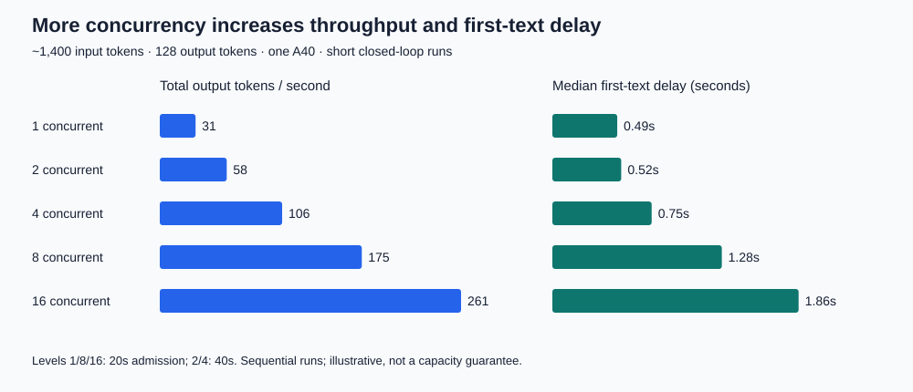
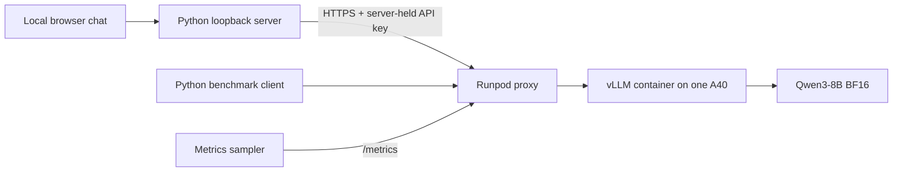

# Open-Source LLM Inference Serving Lab

A deployed Qwen3-8B chat demo and reproducible experiments connecting GPU serving behavior to product decisions. Built to understand latency, capacity, quality and cost before adding infrastructure complexity.

**Result:** one A40 served eight short-prompt requests in parallel with little per-request slowdown. With document-sized inputs, first-text latency rose as concurrency increased. Longer outputs reduced completed requests per second even when aggregate token throughput stayed similar.



## Architecture



The browser never receives the model API key. The demo streams responses, keeps session conversation history, reports first-text and completion time, offers 512/1,024-token caps, and flags truncated answers. It has no browsing/retrieval tools. A model answer to a URL is not evidence that the article was fetched.

## Measured findings

| Experiment | Observation | Product implication |
|---|---|---|
| Short prompt, 1 → 8 concurrent requests | 32.6 → 253.1 total output tokens/s; completion ~4s | Batching can improve efficiency before responsiveness suffers |
| ~1,400 input tokens, 2 → 4 concurrent | Median first text 0.52 → 0.75s; 100% → 92% met provisional targets | Choose a latency target, then a candidate operating point |
| 128 → 512 output tokens, concurrency 2 | Completion 4.37 → 15.65s; completed requests/s 0.46 → 0.13 | Token throughput alone hides fewer completed user tasks |
| ~234 → ~2,997 input tokens, concurrency 2 | First text 0.26 → 0.93s | Context length affects responsiveness |
| Final instrumented run, concurrency 8 | Mean queue 0.27s, prefill 0.62s, decode 4.64s; sampled KV peak 7.91% | Queueing exists without a full KV cache; longer generation dominates completion |

Targets were provisional: first text within 1s and completion within 10s. Quality was explored separately through user-scored prompts. These are small exploratory runs, not production SLAs. Results use different workloads across experiment families: compare within each family. Forced-length benchmarks deliberately disable normal end-of-answer stopping; the regular chat demo does not.

## Run the demo

Python 3.9+ and a funded Runpod account with a running compatible GPU Pod are required. Local scripts use only Python's standard library.

1. Review `inference-lab/deployment.json`: pinned vLLM image and model revision, one A40, CUDA >=13.0, BF16, context 4,096, max 16 active sequences, 20GB container disk and 30GB persistent workspace. Provision through Runpod with these settings, checking current stock and price. `${VLLM_API_KEY}` is a placeholder: substitute a new secret before sending the configuration; JSON does not expand it automatically. Expose only the required 8000 HTTP port.
2. Wait for model startup. Copy the sample secret file and set the same key as the Pod:

```bash
cp inference-lab/.env.example inference-lab/.env
chmod 600 inference-lab/.env
# Edit inference-lab/.env locally; never commit it.
export VLLM_BASE_URL='https://YOUR_POD_ID-8000.proxy.runpod.net'
python3 inference-lab/chat_server.py
```

3. Open http://127.0.0.1:8765/. The local server binds only to loopback. The deployment endpoint is an API, not a hosted chat page. Migrating the Pod changes its ID/URL: update VLLM_BASE_URL and restart the local server.

## Reproduce the experiments

Run from this project root with the same VLLM_BASE_URL and local .env:

```bash
python3 inference-lab/benchmark_concurrency.py
python3 inference-lab/benchmark_sustained.py --concurrency 2 4 --seconds 40 --output followup-results.json
python3 inference-lab/benchmark_sustained.py --concurrency 2 --seconds 40 --max-tokens 512 --output long-output-results.json
python3 inference-lab/benchmark_sustained.py --concurrency 2 --seconds 30 --input-rows 5 --output short-input-results.json
python3 inference-lab/benchmark_sustained.py --concurrency 2 --seconds 30 --input-rows 75 --output long-input-results.json
python3 inference-lab/benchmark_instrumented.py
```

These send real traffic to a running GPU. Each command has bounded load but does not manage the Pod lifecycle. Result filenames may be overwritten. Do not run unrelated traffic during the instrumented experiment: its histogram deltas are global. Historical reports/raw files are in `inference-lab/`; the chart is a historical snapshot.

## Cost and scaling decisions

The live Pod read on October 28, 2026 reported **$0.59/hour compute**. At that rate, 2 GPU hours is $1.18 and 24 hours is $14.16, excluding storage. This is allocated-instance time: an idle running Pod still costs money. Rates and availability can change. Storage is separate; stopping compute retains the persistent disk and its charges. See [Runpod pricing](https://docs.runpod.io/pods/pricing) and check the console before deployment.

Illustration using the measured 128-token concurrency-2 rate: $0.59 / (0.455 completed requests/s × 3,600) ≈ $0.00036 compute per completed response **only if that measured utilization were sustained**. This extrapolation is not a measured invoice or production forecast. Idle time, storage, workload mix, retries and quality acceptance change the result.

Continuous batching shares one GPU across active sequences. Vertical scaling uses a more capable GPU or more resources per replica. Horizontal scaling adds independent replicas, increasing aggregate capacity and enabling redundancy, while duplicating model memory and requiring routing. Kubernetes is optional: it becomes useful for scheduling, health management and autoscaling across a larger deployment. Traffic growth alone does not require it.

For an AI Inference Advisor, these measurements can inform workload-specific recommendations using input/output lengths, concurrency, latency objectives and utilization assumptions. This lab provides evidence and example data; no production integration with the existing Advisor has been implemented. Quantization, a deliberate KV-cache pressure test, and replica/failure comparisons remain future work. Approximate TPOT is recorded in the burst results; latency-qualified goodput excludes answer quality. Cost per million tokens has not yet been calculated.

## Evidence and limitations

Start with [instrumented results](inference-lab/instrumented-benchmark.md), then [quality evaluation](inference-lab/quality-evaluation.md), [concurrency](inference-lab/concurrency-benchmark.md), [operating point](inference-lab/interactive-operating-point.md), [output length](inference-lab/output-length-benchmark.md) and [input length](inference-lab/input-length-benchmark.md).

Client timings include network/proxy delay. Closed-loop bursts and short admission windows are not realistic independent arrivals or maximum capacity estimates. Tail statistics have small samples. Synthetic prompts and prefix caching affect generalization. Server metrics add queue/prefill/decode and sampled KV evidence, but GPU utilization was not reliably measured. Quality scores were user-reported. No public availability, load-balancing, failover or Kubernetes claims are made.

## Resume in another session

“Read this README and the instrumented report. The first portfolio version is complete. Inspect existing endpoint state before any billable action. Explain the findings and remaining limitations; prioritize packaging or a chosen product question over more benchmarks. Do not expose .env or publish credentials. Optional next work: repeat realistic traffic with an agreed latency target, or evaluate quantization/replicas.”

Official references: [Qwen3-8B model](https://huggingface.co/Qwen/Qwen3-8B), [vLLM Docker](https://docs.vllm.ai/en/latest/deployment/docker/), [vLLM metrics](https://docs.vllm.ai/en/latest/design/metrics/), [Runpod pricing](https://docs.runpod.io/pods/pricing).
